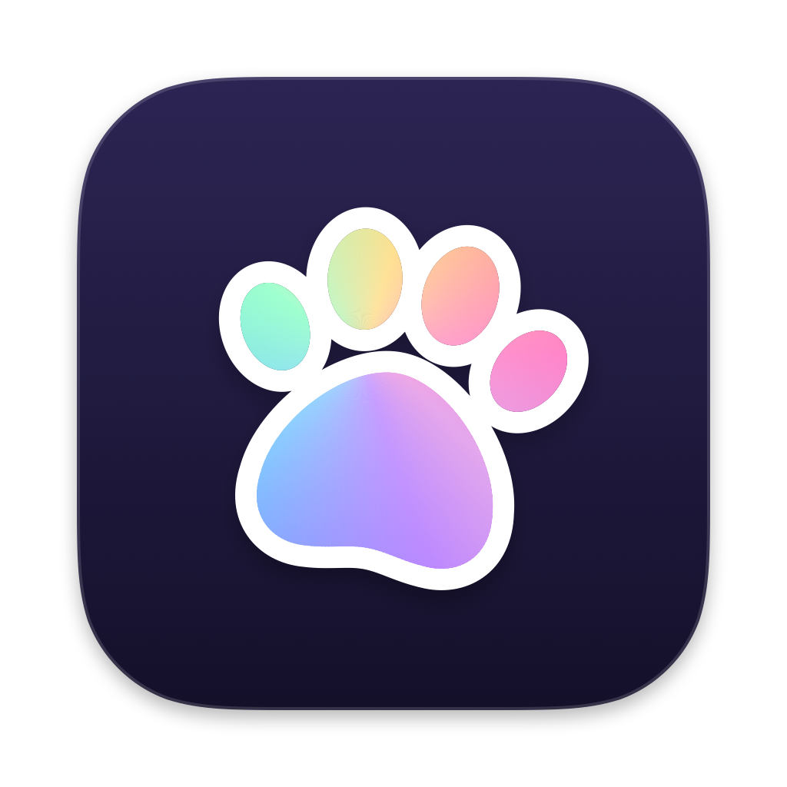
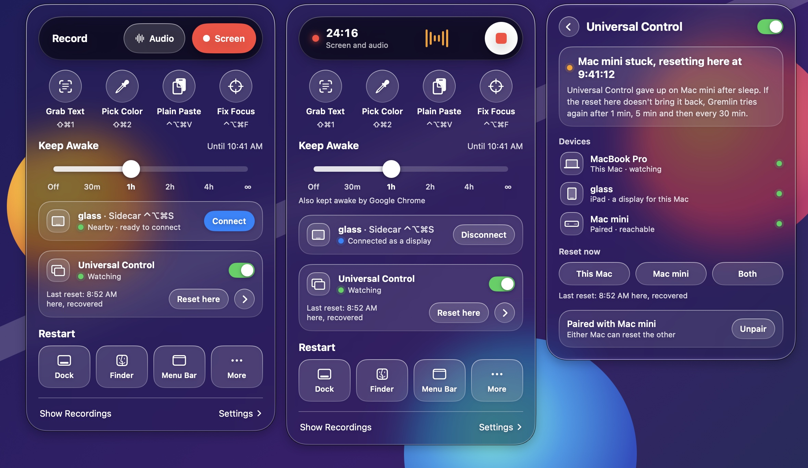
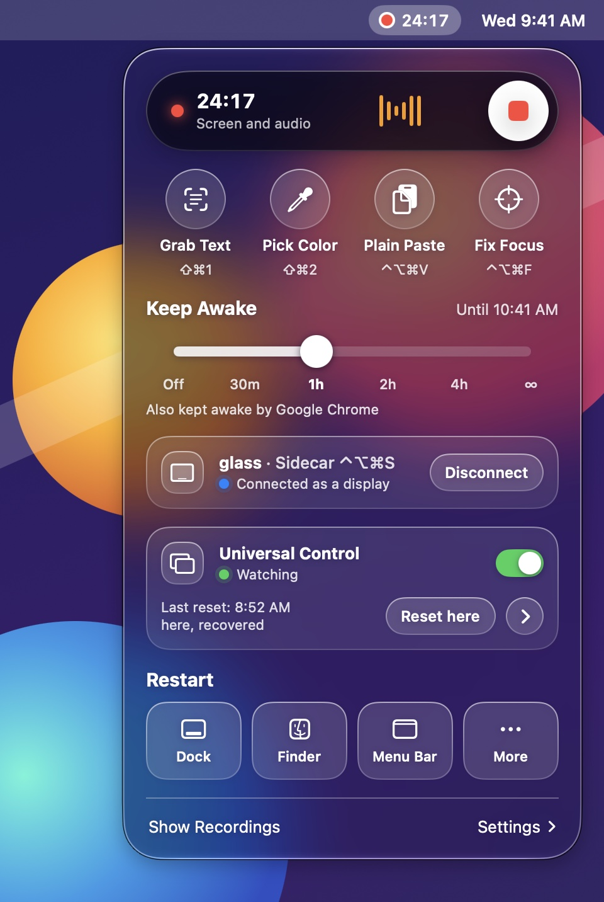
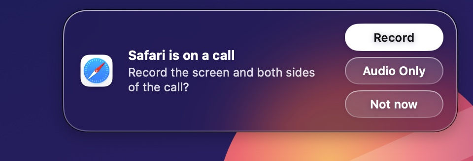
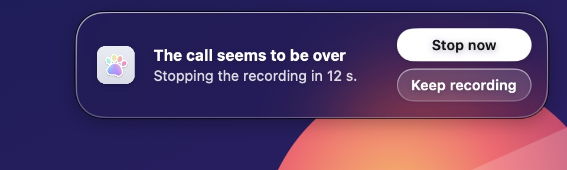
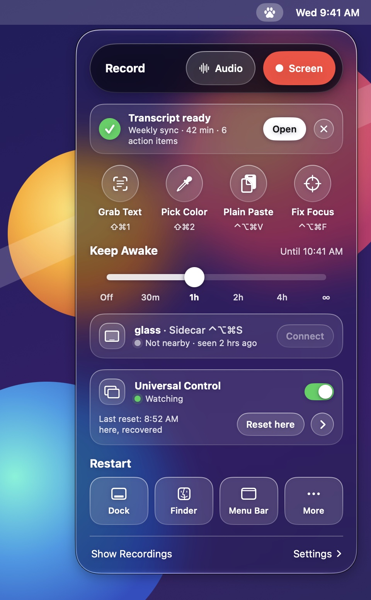
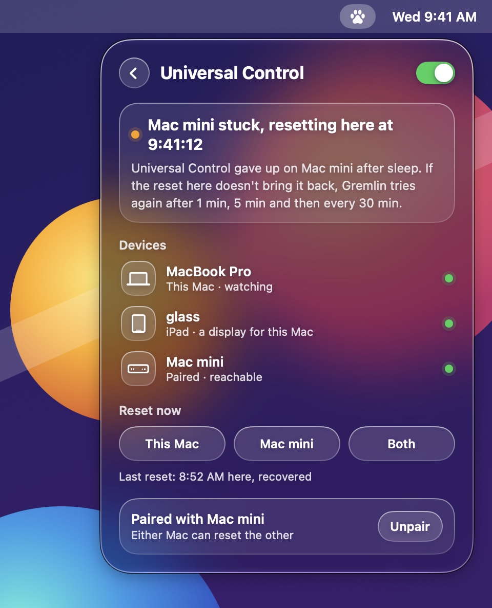
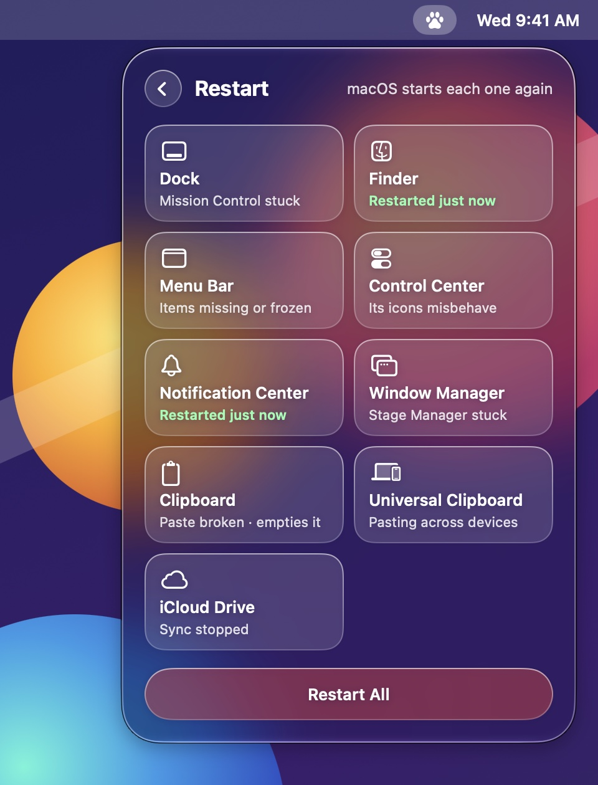
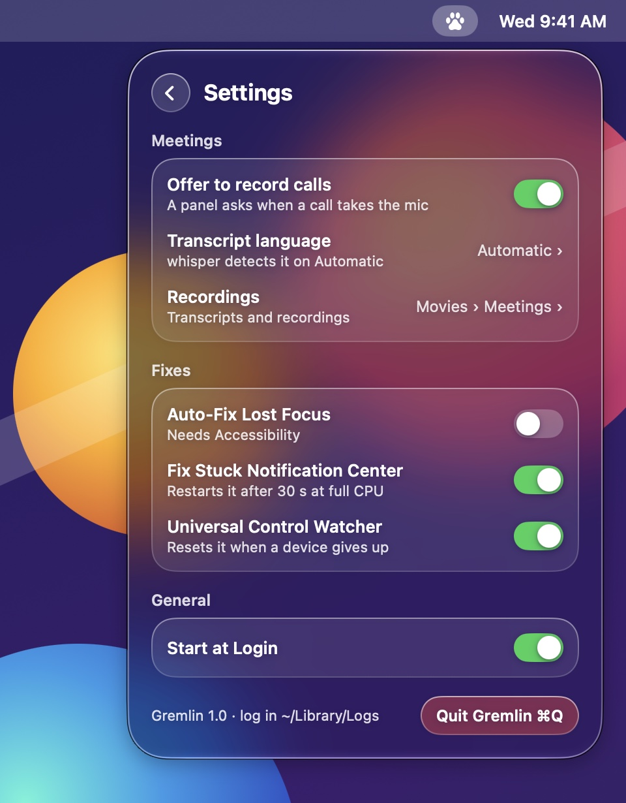

<p align="center">
  
</p>

<h1 align="center">Gremlin</h1>

<p align="center">
  <b>A little Liquid Glass panel in the menu bar that fixes the everyday kinks of macOS.</b><br>
  It records meetings with a transcript, grabs text and colors off the screen,<br>
  and unsticks the Dock, Finder, Notification Center and Universal Control.
</p>

<p align="center">
  
  
  
  
</p>

<p align="center">
  <a href="#meetings">Meetings</a> ·
  <a href="#tools">Tools</a> ·
  <a href="#keep-awake">Keep Awake</a> ·
  <a href="#ipad-as-a-display">iPad</a> ·
  <a href="#universal-control">Universal Control</a> ·
  <a href="#restart">Restart</a> ·
  <a href="#make-the-glass-yours">Glass</a> ·
  <a href="#install">Install</a>
</p>

<p align="center">
  
</p>

Click the paw in the menu bar and a glass panel drops down with everything in one place. Each part below is a section of that panel. Pages like Restart, Universal Control and Settings slide in, and the glass stretches to fit them. Escape or a click anywhere else closes it.

It's a handful of Swift files built from the command line. It needs nothing else, except Homebrew's whisper.cpp and ffmpeg for meeting transcripts. It runs as you and never asks for an admin password.

## Meetings

<table>
<tr>
<td width="50%"></td>
<td>

**Record** sits at the top of the panel. **Screen** records the screen the pointer is on, with all sound and your mic. **Audio** records just the two sides of the call, with no video.

While it runs, the menu bar shows a red record button and how long it has been going. **Click it to stop**, or right-click it for the panel. The strip shows the time and bars that move while sound is coming in and lie flat through silence.

- <kbd>⌃</kbd><kbd>⌥</kbd><kbd>⌘</kbd><kbd>R</kbd> records the screen and audio
- <kbd>⌃</kbd><kbd>⌥</kbd><kbd>⌘</kbd><kbd>A</kbd> records audio only

Either one stops a recording that's running.

</td>
</tr>
</table>

### It offers when a call starts

When a browser or a meeting app (Zoom, Teams, Webex, Slack, FaceTime) has used the mic for 5 seconds, a panel under the menu bar asks whether to record the call. **Record** records the screen the call's window is on, **Audio Only** skips the video, and **Not now** leaves that call alone until the app lets go of the mic.

<p align="center">
  
</p>

When a recorded call goes quiet, meaning its app has stopped using both the mic and the speakers for 8 seconds, the panel counts down 15 seconds before stopping.

<p align="center">
  
</p>

These panels show over full-screen apps and appear even with notifications or a Focus turned off. Nothing is ever recorded without you asking, and **Offer to record calls** in Settings turns the offers off.

### After the call

<table>
<tr>
<td>

The recording's folder opens in Finder as soon as you stop. The panel then shows how the transcript is coming along, and **Transcript ready** when it's done, with the meeting's length and how many action items it found. **Open** shows `transcript.md` in Finder.

```
~/Movies/Meetings/2026-10-21 11.00 Weekly sync/
├── transcript.md   summary, decisions, action items, transcript
├── recording.mp4   the compressed screen recording
└── event.json      the calendar event it happened during
```

An audio-only recording ends up as `recording.m4a` instead.

</td>
<td width="50%"></td>
</tr>
</table>

- **Transcript.** Written on the Mac by [whisper.cpp](https://github.com/ggml-org/whisper.cpp) (`brew install whisper-cpp`), labelled **Me** (your mic) and **Them** (the call). whisper detects the language, Turkish and English included, or you can pick one under **Transcript language** in Settings. Without headphones your mic also hears the call, and those duplicate lines are dropped. Without whisper, Gremlin falls back to Apple's speech recognition, which only knows a few languages.
- **Summary.** If the [Claude Code](https://claude.com/claude-code) CLI is installed, `claude -p` adds a summary, decisions and action items in English at the top, using your Claude login rather than an API key.
- **Names.** With calendar access, a recording is named after the event it happened during, and the transcript and summary list who was invited.
- **Smaller copy.** [ffmpeg](https://ffmpeg.org) (`brew install ffmpeg`) compresses the video with x265 at CRF 26 and mixes the call and your mic into one audio track. While any app is using the mic it runs at background priority, so it doesn't slow down a call. An hour-long call takes roughly 15 minutes on an M5.

<details>
<summary><b>Recording details</b></summary>

While recording, and until the compressed copy is done, the folder holds `recording.mov`: 15 fps, one pixel per point of the screen and at most 2560 px, with all other sound and your mic on separate tracks. Recording at Retina resolution and 30 fps made calls drop frames. It's written in 10-second fragments, so a crash or a power cut loses at most the last few seconds. Gremlin moves it to the Trash once the compressed copy is the same length. Without ffmpeg, it is kept.

The panel warns you, and a panel pops up, if the mic sends nothing, or only silence for the first 90 seconds, or if the file stops growing. If recording can't start, Gremlin says so in a dialog and in the panel, with a **Fix** button when it's a missing permission.

The first transcript downloads whisper's model (large-v3-turbo, about 875 MB) and a voice detection model to `~/Library/Application Support/Gremlin/Models`. After that, a call is transcribed in a fraction of its length: 3 minutes of Turkish took 24 seconds on an M5. If Gremlin quits before a meeting is transcribed or compressed, it finishes the job the next time it starts.

</details>

## Tools

The row of round buttons under Record. Each one also has a shortcut that works anywhere.

| Tool | What it does |
| --- | --- |
| **Grab Text**<br><kbd>⇧</kbd><kbd>⌘</kbd><kbd>1</kbd> | Drag over any part of the screen (space switches to window mode) and the text in it goes to the clipboard. It uses Apple's on-device text recognition, the same engine as Live Text. If the selection has a **QR code or barcode**, its content is copied instead. |
| **Pick Color**<br><kbd>⇧</kbd><kbd>⌘</kbd><kbd>2</kbd> | Opens the system color loupe. The color you click goes to the clipboard as sRGB hex, e.g. `#1e1e2e`. |
| **Plain Paste**<br><kbd>⌃</kbd><kbd>⌥</kbd><kbd>⌘</kbd><kbd>V</kbd> | Strips the formatting from the clipboard and pastes. |
| **Fix Focus**<br><kbd>⌃</kbd><kbd>⌥</kbd><kbd>⌘</kbd><kbd>F</kbd> | Fixes the menu bar showing one app while your typing goes nowhere, or to a window behind it. That happens most after switching Spaces or using Universal Control. Gremlin takes focus for a moment, hands it back to the app whose window is on top, and raises that window. |

**Auto-Fix Lost Focus** in Settings does that last one for you. It steps in when the frontmost app has windows on screen but none of them has focus, or another app's window sits on top of them, for 3 seconds. Apps that never report focus properly are left alone after one try. It's off by default because it needs Accessibility permission.

## Keep Awake

Keeps the display and the Mac awake for 30 minutes to 4 hours, or until you turn it off (∞). Drag the knob or click a stop. The panel shows when it ends and lists any other app that is keeping the Mac awake, and the knob slides down as time runs out. It survives a Gremlin restart until its time is up.

## iPad as a display

The iPad card shows your iPad's name and whether it's nearby, connected as a display, or away and when it was last seen. **Connect** (<kbd>⌃</kbd><kbd>⌥</kbd><kbd>⌘</kbd><kbd>S</kbd>) makes it a Sidecar display, and **Disconnect** gives it back. It always takes the iPad: an iPad that is a display for another Mac switches over, and a session this Mac is still holding is dropped and started fresh. With several iPads nearby, it picks the first one.

It uses the same private SidecarCore calls as the Displays menu in Control Center. If a macOS update changes them, the card disappears instead of misbehaving.

## Universal Control

<table>
<tr>
<td width="50%"></td>
<td>

**What it is.** Universal Control lets one keyboard and mouse work across Macs and iPads sitting next to each other. You move the pointer past the edge of one screen and keep going on the next device.

**The pain.** After a Mac wakes up, the devices sometimes fail their first handshake, and macOS gives up for good. The pointer stays stuck on one side until you go into System Settings on the right Mac and turn Universal Control off and on.

**The fix.** Gremlin reads Universal Control's logs to spot the moment it gives up, and toggles it for you, retrying with increasing delays. Paired Gremlins talk over the local network, so whichever Mac notices the problem can get the *other* Mac to toggle.

The card in the panel shows what the watcher sees and when it last reset, with **Reset now** (**Reset here** once you've paired another Mac). The **›** button opens this page: the devices, a reset on this Mac, the other one or both, and pairing.

</td>
</tr>
</table>

To pair, install Gremlin on both Macs, choose **Pair Another Mac…** on each, and click Pair on both if the 6-digit codes match. The details are [further down](#how-the-universal-control-fix-works).

## Restart

<table>
<tr>
<td>

When part of macOS hangs, restarting just that part usually fixes it, without logging out. The panel has Dock, Finder and Menu Bar one click away, and **More** opens all of them. A tile restarts its part straight away and says so. **Restart All** asks for a second click, since it also empties the clipboard.

All of these run as you, and macOS starts them again right away.

**Fix Stuck Notification Center** in Settings watches for a macOS 27 bug where a banner freezes halfway in and Notification Center spins at 100% CPU. If it stays above 90% for 30 seconds, Gremlin restarts it. It's on by default.

</td>
<td width="50%"></td>
</tr>
</table>

| Tile | Restarts | Try it when |
| --- | --- | --- |
| Dock | `Dock` | Mission Control, Spaces or <kbd>⌃</kbd>-number shortcuts stop working, often after sleep |
| Finder | `Finder` | Finder windows or the desktop stop responding |
| Menu Bar | `SystemUIServer` | Menu bar items are missing or frozen |
| Control Center | `ControlCenter` | Control Center or its menu bar icons misbehave |
| Notification Center | `NotificationCenter` | Banners freeze or notifications stop showing |
| Window Manager | `WindowManager` | Stage Manager or window tiling gets stuck |
| Clipboard | `pboard` | Copy, paste or drag and drop stop working. This empties the clipboard. |
| Universal Clipboard | `useractivityd`, then `pboard` | Copying on one device no longer pastes on another |
| iCloud Drive | `bird` | iCloud Drive stops syncing |

## Settings

<table>
<tr>
<td width="50%"></td>
<td>

**Settings ›** at the bottom of the panel turns features on and off, and Gremlin remembers them between launches.

- **Offer to record calls**: the call panel above.
- **Transcript language**: Automatic, or a language for whisper to assume.
- **Auto-Fix Lost Focus**, **Fix Stuck Notification Center**, **Universal Control Watcher**: the background fixes.
- **Start at Login**: on after installing.

Everything Gremlin does is logged to `~/Library/Logs/Gremlin.log`.

</td>
</tr>
</table>

## Make the glass yours

Every surface, from the panel and its cards and buttons to the record strip and the call panels, takes its look from one place: `GlassLook` in [`Glass.swift`](Glass.swift). By default it's Liquid Glass over a dark blur, so it reads well over any window. For more color, or for glass you can see through, change it:

```sh
defaults write com.bunniesinc.gremlin glass.tint -float 0.45
defaults write com.bunniesinc.gremlin glass.material clear
```

The next panel that opens uses it, with no rebuild. `defaults delete com.bunniesinc.gremlin glass.tint` goes back to the default.

| Key | Default | What it changes |
| --- | --- | --- |
| `glass.material` | `frosted` | `frosted`, Liquid Glass over a dark blur that reads well anywhere; `regular` Liquid Glass; or `clear`, which is see-through and only readable over dark, plain backgrounds |
| `glass.tint` | `0.24` | How strongly the tint color covers the glass |
| `glass.tintColor` | `#1E1446` | The tint color |
| `glass.radius` | `30` | The panel's corner radius |
| `glass.rim` | `0.42` | How bright the panel's edge is |
| `glass.textShadow` | `0.35` | The faint shadow that keeps white text readable |
| `glass.subtext` | `0.84` | How bright secondary text is |
| `glass.card` | `0.10` | How filled the cards are |
| `glass.control` | `0.15` | How filled buttons, pills and tiles are |
| `glass.strip` | `0.62` | How dark the record strip is |

## Install

Requires macOS 27 and the Xcode Command Line Tools (`xcode-select --install`).

```sh
git clone https://github.com/alicin/gremlin.git
./gremlin/install.sh
```

This builds `/Applications/Gremlin.app`, signs it, starts it, and adds it as a login item. Run `install.sh` again after pulling changes. It needs an admin account to write to `/Applications`, but no password.

For meeting transcripts and the compressed video, also install whisper.cpp and ffmpeg:

```sh
brew install whisper-cpp ffmpeg
```

The app is signed with a self-signed "Gremlin Code Signing" certificate that the installer creates in your login keychain the first time. macOS ties permissions to that certificate, so they survive rebuilds. The first build may ask to let `codesign` use the key; choose Always Allow.

### Permissions

macOS asks for each permission the first time a feature needs it:

| Permission | Needed for |
| --- | --- |
| Screen Recording | Grab Text, recording meetings (audio-only ones too, since the call's sound comes through screen capture) |
| Microphone | Recording your side of a meeting |
| Accessibility | Auto-Fix Lost Focus, and the paste step of Plain Paste (without it, the clipboard is still made plain and you press <kbd>⌘</kbd><kbd>V</kbd>) |
| Local Network | Pairing with another Mac |
| Notifications | Universal Control reset results, finished transcripts |
| Calendars | Naming meeting recordings after the event |

The shortcuts use Carbon hotkeys, so they need no permission.

## How the Universal Control fix works

### The bug in detail

Seen on macOS 27.0 (26A428). When the other Mac wakes or comes back into range, Universal Control runs an "initial sync". If the other Mac isn't ready yet, all 6 retries fail. This Mac then marks the peer `valid=false` and never retries on its own. The other Mac keeps opening a connection every 60 s over AWDL, gets no answer, and hangs up, forever. It only recovers when the peer disappears and comes back, or Universal Control is toggled.

### Detecting and resetting

It streams Universal Control's logs as the current user:

```sh
/usr/bin/log stream --style ndjson --predicate 'process == "UniversalControl" AND category == "SYNC"'
```

- **Gave up:** `IDS <peer>: Initial Sync (Retry 6 of 6)`, then `IDS <peer>: Initial Sync Failed: …`, then `IDS <peer>: available=true, valid=false`
- **Recovered:** `In-Circle Devices: [<peer>]`
- **Peer gone:** `IDS <peer>: Device Unavailable` / `Device Lost`

`<peer>` is any 8-hex-digit device ID. How long the retries take depends on the failure. `-6722` means the other Mac didn't answer, and each retry waits up to ~30 s. `-71143` means the other Mac reset the connection during pairing verification, and all 6 retries fail within seconds. `-6773` is an iPad refusing because it is busy as a Sidecar display, for this Mac or another one. No reset helps with that, so the watcher leaves it alone.

When a peer gives up, the watcher waits 10 s and flips the same setting as the System Settings toggle, off for 3 s and back on:

```sh
defaults -currentHost write com.apple.universalcontrol Disable -bool true
sleep 3
defaults -currentHost write com.apple.universalcontrol Disable -bool false
```

The flip makes the peer go unavailable and available again and starts a fresh initial sync. The watcher ignores that unavailable/available pair and judges the reset by the result of the new sync: the peer joining is a recovery, and giving up again is a failed reset. Failed resets back off (10 s, 1 min, 5 min), then it tries again every 30 min while the peer stays stuck. It never resets a peer that is away, and it restarts `log stream` if it exits. If Gremlin quits mid-flip, Universal Control is switched back on at quit or on the next launch.

Flipping it on this Mac does not always help. When the other Mac is the one refusing the connection (`-71143`), resets here change nothing and it needs a toggle over there. That is what pairing is for.

### Two Macs: pairing and coordination

Install Gremlin on both Macs and choose **Pair Another Mac…** on each within 2 minutes. Both show a 6-digit code. Click Pair on both if the codes match. The first time, macOS asks to allow Gremlin to find devices on the local network.

Once paired, the Macs talk over the local network (Bonjour, `_gremlin._tcp`, TCP port 47101), not over the AWDL link Universal Control uses. When Bonjour can't see the other Mac, Gremlin tries the addresses it last reported, which includes its Tailscale address. Only three messages exist: `status`, `reset` (flip Universal Control on the receiving Mac) and `stuck` (tell the other Mac what this one sees). Each is signed with a key agreed during pairing (Curve25519, HMAC-SHA256), with a timestamp and nonce so it can't be replayed. The key is kept in the login keychain.

Only one of the two Macs runs the resets, so they don't toggle each other at the same time. The other one reports what it sees to that Mac and waits. When a Mac logs `-71143`, the other Mac refused, so the first reset happens on the refusing Mac. Otherwise it happens on the Mac that saw the failure. The next ones go to the other Mac, then both. If the other Mac can't be reached, each Mac falls back to resetting itself.

The Universal Control page does the same by hand: on this Mac, on the other one, or on both.

Resets and their results go to the panel, to a notification, and to `~/Library/Logs/Gremlin.log`.

Don't reset Universal Control any other way. `killall UniversalControl` is ignored, `launchctl kickstart -k gui/$UID/com.apple.ensemble` is refused by SIP, and `kill -9` gets it relaunched but left the other Mac holding a dead session until Universal Control was toggled on that Mac.

<details>
<summary><b>Uninstall</b></summary>

Turn off Start at Login, quit Gremlin, then:

```sh
rm -rf /Applications/Gremlin.app
rm -rf ~/Movies/Meetings  # only if you don't want the recordings
rm -rf ~/Library/Application\ Support/Gremlin
defaults delete com.bunniesinc.gremlin
security delete-generic-password -s com.bunniesinc.gremlin.peer ~/Library/Keychains/login.keychain-db
security delete-identity -c "Gremlin Code Signing" ~/Library/Keychains/login.keychain-db
```

</details>
