<p align="center">
  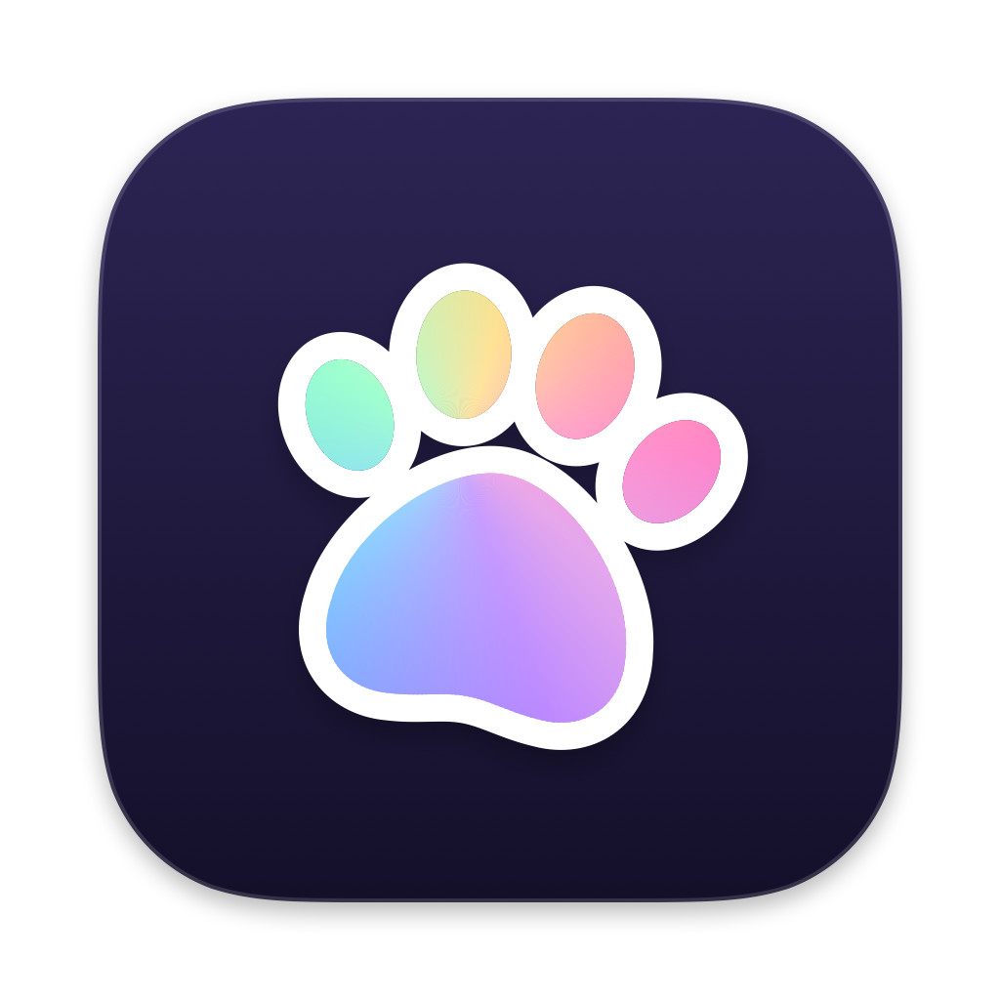
</p>

<h1 align="center">Gremlin</h1>

<p align="center">
  <b>A little Mac app behind a paw in the menu bar that fixes the everyday kinks of macOS.</b><br>
  It records meetings with a transcript, grabs text and colors off the screen, sends every link to the right browser,<br>
  mounts your servers in Finder, puts your displays back, gives each mouse its own scroll direction,<br>
  switches Tailscale and WireGuard, and unsticks the Dock, Finder, Notification Center and Universal Control.
</p>

<p align="center">
  
  
  
  
</p>

<p align="center">
  <a href="#meetings">Meetings</a> ·
  <a href="#tools">Tools</a> ·
  <a href="#keep-awake">Keep Awake</a> ·
  <a href="#ipad-as-a-display">iPad</a> ·
  <a href="#universal-control">Universal Control</a> ·
  <a href="#scrolling">Scrolling</a> ·
  <a href="#links">Links</a> ·
  <a href="#drives">Drives</a> ·
  <a href="#vpn">VPN</a> ·
  <a href="#displays">Displays</a> ·
  <a href="#restart">Restart</a> ·
  <a href="#the-shelf">Shelf</a> ·
  <a href="#install">Install</a>
</p>

<p align="center">
  <picture><source media="(prefers-color-scheme: dark)" srcset="docs/hero-dark.jpg">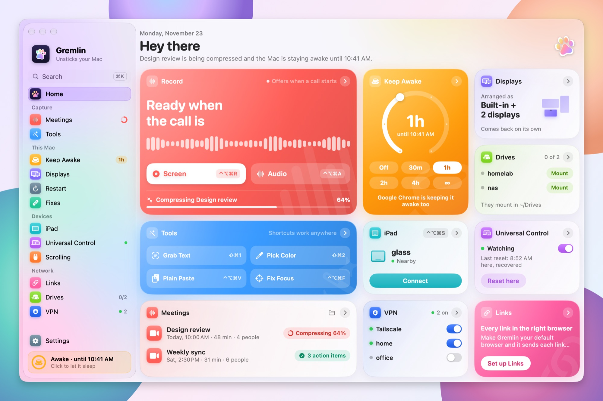</picture>
</p>

Click the paw in the menu bar and Gremlin's window opens on **Home**, a board with a live widget for each utility, and a sidebar with each one's own page. <kbd>⌘</kbd><kbd>K</kbd> searches the sidebar and <kbd>⌘</kbd><kbd>,</kbd> opens Settings. For a quick switch without the window, <kbd>⌃</kbd><kbd>⌥</kbd><kbd>⌘</kbd><kbd>G</kbd> raises [the shelf](#the-shelf) from the bottom of the screen. Gremlin stays out of the Dock; opening it from Finder or Spotlight shows the window too.

It's a handful of Swift files built from the command line. It needs nothing else, except Homebrew's whisper.cpp and ffmpeg for meeting transcripts. It runs as you and never asks for an admin password.

## Meetings

<p align="center">
  <picture><source media="(prefers-color-scheme: dark)" srcset="docs/meetings-dark.jpg">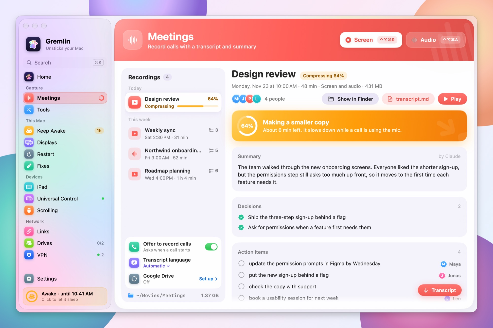</picture>
</p>

**Screen** records the screen the pointer is on, with all sound and your mic. **Audio** records just the two sides of the call, with no video. Both are on Home's Record widget and at the top of the Meetings page.

While it runs, the paw turns into a red record button with how long it has been going. **Click it to stop**, or right-click it for the window. The Record widget shows the time and bars that move while sound is coming in and lie flat through silence.

- <kbd>⌃</kbd><kbd>⌥</kbd><kbd>⌘</kbd><kbd>R</kbd> records the screen and audio
- <kbd>⌃</kbd><kbd>⌥</kbd><kbd>⌘</kbd><kbd>A</kbd> records audio only

Either one stops a recording that's running.

### It offers when a call starts

When a browser or a meeting app (Zoom, Teams, Webex, Slack, FaceTime) has used the mic for 5 seconds, a prompt under the menu bar asks whether to record the call. **Record** records the screen the call's window is on, **Audio Only** skips the video, and **Not now** leaves that call alone until the app lets go of the mic.

<p align="center">
  <picture><source media="(prefers-color-scheme: dark)" srcset="docs/call-offer-dark.jpg">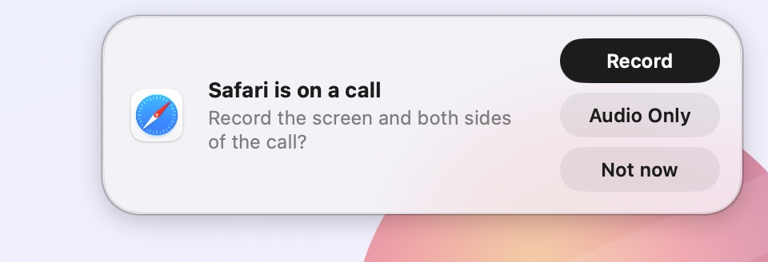</picture>
</p>

When a recorded call goes quiet, meaning its app has stopped using both the mic and the speakers for 8 seconds, the prompt counts down 15 seconds before stopping.

<p align="center">
  <picture><source media="(prefers-color-scheme: dark)" srcset="docs/call-ended-dark.jpg">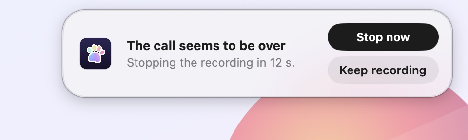</picture>
</p>

These prompts show over full-screen apps and appear even with notifications or a Focus turned off. Nothing is ever recorded without you asking, and **Offer to record calls** in Settings turns the offers off.

### After the call

The recording's folder opens in Finder as soon as you stop. Home then shows how the transcript is coming along, and **Transcript ready** when it's done, with the meeting's length and how many action items it found.

The **Meetings** page lists every recording by day. Pick one for its summary, decisions, action items with who owns each, and the transcript, with **Play**, **Show in Finder** and **transcript.md**. While a smaller copy is being made, it shows the percentage and the time left.

```
~/Movies/Meetings/2026-10-21 11.00 Weekly sync/
├── transcript.md   summary, decisions, action items, transcript
├── recording.mp4   the compressed screen recording
└── event.json      the calendar event it happened during
```

An audio-only recording ends up as `recording.m4a` instead.

- **Transcript.** Written on the Mac by [whisper.cpp](https://github.com/ggml-org/whisper.cpp) (`brew install whisper-cpp`), labelled **Me** (your mic) and **Them** (the call). whisper detects the language, Turkish and English included, or you can pick one under **Transcript language** in Settings. Without headphones your mic also hears the call, and those duplicate lines are dropped. Without whisper, Gremlin falls back to Apple's speech recognition, which only knows a few languages.
- **Summary.** If the [Claude Code](https://claude.com/claude-code) CLI is installed, `claude -p` adds a summary, decisions and action items in English at the top, using your Claude login rather than an API key.
- **Names.** With calendar access, a recording is named after the event it happened during, and the transcript and summary list who was invited.
- **Smaller copy.** [ffmpeg](https://ffmpeg.org) (`brew install ffmpeg`) compresses the video with x265 at CRF 26 and mixes the call and your mic into one audio track. While any app is using the mic it runs at background priority, so it doesn't slow down a call. An hour-long call takes roughly 15 minutes on an M5.

<details>
<summary><b>Recording details</b></summary>

While recording, and until the compressed copy is done, the folder holds `recording.mov`: 15 fps, one pixel per point of the screen and at most 2560 px, with all other sound and your mic on separate tracks. Recording at Retina resolution and 30 fps made calls drop frames. It's written in 10-second fragments, so a crash or a power cut loses at most the last few seconds. Gremlin moves it to the Trash once the compressed copy is the same length. Without ffmpeg, it is kept.

Gremlin warns you on Home, and a prompt pops up, if the mic sends nothing, or only silence for the first 90 seconds, or if the file stops growing. If recording can't start, Gremlin says so in a dialog and on Home, with a **Fix** button when it's a missing permission.

The first transcript downloads whisper's model (large-v3-turbo, about 875 MB) and a voice detection model to `~/Library/Application Support/Gremlin/Models`. After that, a call is transcribed in a fraction of its length: 3 minutes of Turkish took 24 seconds on an M5. If Gremlin quits before a meeting is transcribed or compressed, it finishes the job the next time it starts.

</details>

### Sync between Macs

**Sync meetings** in Settings copies every meeting to a **Gremlin Meetings** folder in your Google Drive, and every Mac running Gremlin with the same Google account gets the ones it's missing. Sign in with **Use Clipboard's Google App** when Clipboard already syncs through Google Drive, or with the client ID and secret of your own Google Cloud client, the same one on every Mac. A Web application client needs `http://127.0.0.1:53847` as a redirect URI, like Clipboard's. The Meetings page shows how sync is doing, with a button to sync now.

- **Only adds and updates.** A meeting removed on one Mac, or in Drive, stays everywhere else and isn't copied back. When a newer transcript arrives, say with a summary another Mac added, the copy it replaces goes to the Trash.
- **What syncs.** `transcript.md`, `event.json` and the compressed `recording.mp4` or `recording.m4a`, once a meeting is transcribed. The original `recording.mov` never leaves the Mac.
- **When.** At launch, every 15 minutes, after each transcript or smaller copy is done, and with **Sync Now**. It pauses while recording so uploads don't compete with the call.
- **What Gremlin can reach.** Only files it made, through Google's `drive.file` scope. You can move the Gremlin Meetings folder anywhere in your Drive.

## Tools

On Home's Tools widget and the Tools page. Each one also has a shortcut that works anywhere.

| Tool | What it does |
| --- | --- |
| **Grab Text**<br><kbd>⇧</kbd><kbd>⌘</kbd><kbd>1</kbd> | Drag over any part of the screen (space switches to window mode) and the text in it goes to the clipboard. It uses Apple's on-device text recognition, the same engine as Live Text. If the selection has a **QR code or barcode**, its content is copied instead. |
| **Pick Color**<br><kbd>⇧</kbd><kbd>⌘</kbd><kbd>2</kbd> | Opens the system color loupe. The color you click goes to the clipboard as sRGB hex, e.g. `#1e1e2e`. |
| **Plain Paste**<br><kbd>⌃</kbd><kbd>⌥</kbd><kbd>⌘</kbd><kbd>V</kbd> | Strips the formatting from the clipboard and pastes. |
| **Fix Focus**<br><kbd>⌃</kbd><kbd>⌥</kbd><kbd>⌘</kbd><kbd>F</kbd> | Fixes the menu bar showing one app while your typing goes nowhere, or to a window behind it. That happens most after switching Spaces or using Universal Control. Gremlin takes focus for a moment, hands it back to the app whose window is on top, and raises that window. |

**Auto-Fix Lost Focus** on the Fixes page does that last one for you. It steps in when the frontmost app has windows on screen but none of them has focus, or another app's window sits on top of them, for 3 seconds. Apps that never report focus properly are left alone after one try. It's off by default because it needs Accessibility permission.

## Keep Awake

Keeps the display and the Mac awake for 30 minutes to 4 hours, or until you turn it off (∞). Drag the dial on Home or click a stop. It shows when it ends and lists any other app that is keeping the Mac awake, and the dial winds down as time runs out. The chip at the bottom of the sidebar turns it on for an hour or off in one click. It survives a Gremlin restart until its time is up.

## iPad as a display

The iPad widget shows your iPad's name and whether it's nearby, connected as a display, or away and when it was last seen. **Connect** (<kbd>⌃</kbd><kbd>⌥</kbd><kbd>⌘</kbd><kbd>S</kbd>) makes it a Sidecar display, and **Disconnect** gives it back. It always takes the iPad: an iPad that is a display for another Mac switches over, and a session this Mac is still holding is dropped and started fresh. With several iPads nearby, it picks the first one.

It uses the same private SidecarCore calls as the Displays menu in Control Center. If a macOS update changes them, the iPad page disappears instead of misbehaving.

## Universal Control

<p align="center">
  <picture><source media="(prefers-color-scheme: dark)" srcset="docs/universal-control-dark.jpg">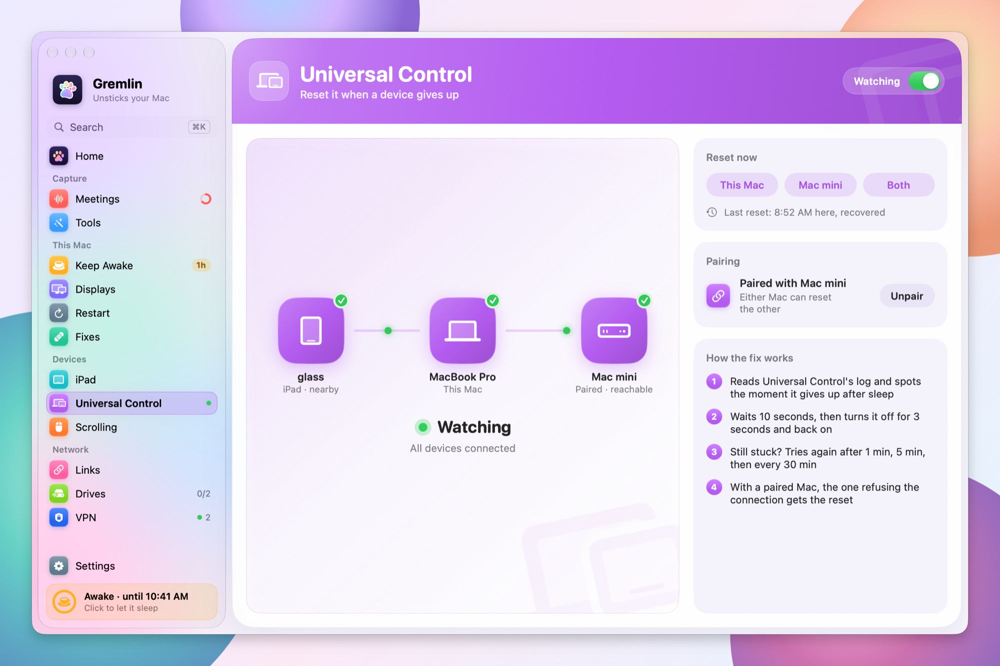</picture>
</p>

**What it is.** Universal Control lets one keyboard and mouse work across Macs and iPads sitting next to each other. You move the pointer past the edge of one screen and keep going on the next device.

**The pain.** After a Mac wakes up, the devices sometimes fail their first handshake, and macOS gives up for good. The pointer stays stuck on one side until you go into System Settings on the right Mac and turn Universal Control off and on.

**The fix.** Gremlin reads Universal Control's logs to spot the moment it gives up, and toggles it for you, retrying with increasing delays. Paired Gremlins talk over the local network, so whichever Mac notices the problem can get the *other* Mac to toggle.

Home's widget shows what the watcher sees and when it last reset, with **Reset here**. The Universal Control page shows the devices, resets this Mac, the other one or both, and pairs Macs. To pair, install Gremlin on both Macs, choose **Pair another Mac…** on each, and click Pair on both if the 6-digit codes match. The details are [further down](#how-the-universal-control-fix-works).

## Scrolling

macOS has one Natural scrolling setting for every mouse and trackpad. Gremlin gives each device its own, so the trackpad can scroll naturally while the mouse scrolls the standard way, like [Scroll Reverser](https://pilotmoon.com/scrollreverser/).

<p align="center">
  <picture><source media="(prefers-color-scheme: dark)" srcset="docs/scrolling-dark.jpg">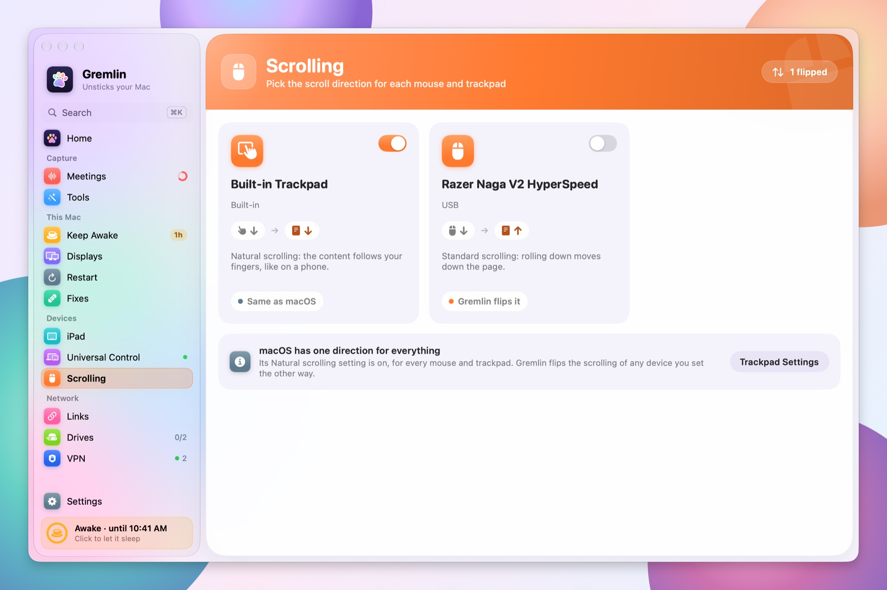</picture>
</p>

The Scrolling page has a card for each mouse and trackpad with a **Natural scrolling** switch. A device you haven't set follows macOS. A card lights up while its device scrolls, which tells apart two mice behind receivers with the same name. A device keeps its setting while it's unplugged, and **Forget** drops it.

- **What it flips.** Both directions of every scroll from a device set the other way from macOS, and apps are told the direction changed, as if macOS had done it. Scrolls from other devices, and from software, pass through untouched.
- **What it costs.** Gremlin only taps scroll events while a device is set the other way, on a thread of its own so a busy Gremlin can't make scrolling lag. Flipping needs Accessibility permission.
- **How it tells devices apart.** Each scroll event names the HID service that sent it, through a private CoreGraphics call (`CGEventCopyIOHIDEvent`). Gremlin looks that service up in IOKit and knows the device by its maker, model and name. If macOS ever drops the call, nothing gets flipped.

## Links

Make Gremlin your default browser and every link you click goes through it first, then on to the right browser, profile or app. It removes the tracking on the way. It's off until you press **Make default** on the Links page, and macOS asks you to confirm.

<p align="center">
  <picture><source media="(prefers-color-scheme: dark)" srcset="docs/links-picker-dark.jpg">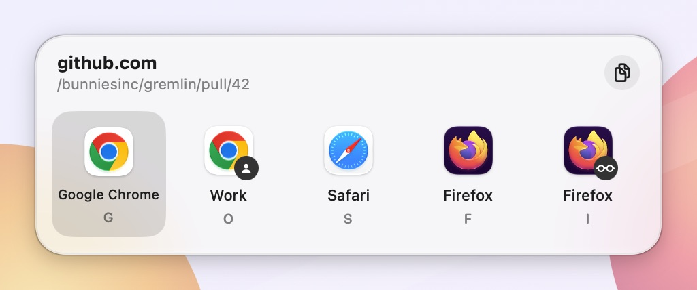</picture>
</p>

### The picker

When a link is set to **Ask Every Time**, a picker opens by the pointer. The app you clicked in stays in front until you choose.

| To | Do this |
| --- | --- |
| Open it | Click a browser, press its letter or number, or use the arrows or <kbd>⌃</kbd><kbd>⇥</kbd> and then <kbd>Return</kbd> |
| Open it behind what you're doing | Hold <kbd>⌃</kbd> while choosing |
| Always open this site there | <kbd>⌘</kbd>-click the browser, which makes a rule |
| Open a new or private window | Right-click the browser |
| Copy the link | <kbd>⌘</kbd><kbd>C</kbd> |
| Drop it | <kbd>Esc</kbd> or click elsewhere |

Links that arrive while it's open join the waiting one, and your choice covers them all.

### Where links go

<p align="center">
  <picture><source media="(prefers-color-scheme: dark)" srcset="docs/links-dark.jpg">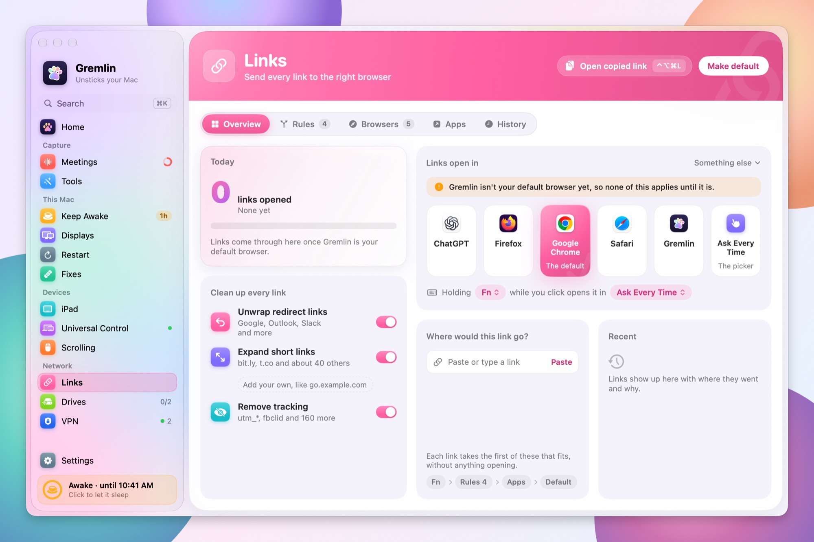</picture>
</p>

Each link takes the first of these that fits:

1. **Holding <kbd>Fn</kbd>**: the alternative you picked. The picker unless you change it, and the key can be Option, Control or Shift for keyboards that don't send Fn.
2. **Your rules**, top to bottom.
3. **Apps**: links for Zoom, Microsoft Teams, Figma, Linear, Notion, Spotify and Discord open in their apps, and Google Meet opens in Chrome, when installed. Each has a switch.
4. **The default**: a browser, a profile, or the picker.

**Where would this link go?** runs a pasted link through all of it and shows the result, without opening anything. Home's Links widget switches the default in one click, and **History** shows where recent links went and why.

### Rules

A rule opens matching links in a browser, a profile, a private window, the picker or any other app. It can match on:

- **The link**: a domain (`github.com` covers its subdomains, and `github.com/bunniesinc` only that path), what the link starts with, or a regex.
- **The app it was clicked in**: helpers count as their app, so Slack's helper process is Slack.

With both, both must fit. A rule can also change the link with a script once it has matched, and **Try a link** checks a rule as you write it. **Copy Rules** and **Paste Rules** move them as JSON, and everything lives in `~/Library/Application Support/Gremlin/links.json`.

Scripts are JavaScript with `url` and `sourceApp`. Return a new link, or nothing to leave it alone:

```js
return url.replace("https://old.example.com", "https://new.example.com")
```

A script under **Before any rule** can change which rule matches, while one on a rule can't. A script that throws or takes over a second is skipped and the link carries on.

### Cleaning up links

Every link goes through these in order, and each has a switch:

1. **Unwrap redirect links**: Google, Outlook SafeLinks, Proofpoint, Facebook, Instagram, LinkedIn, Slack, YouTube and others wrap outgoing links, and Gremlin takes the real one out without asking the network.
2. **Expand short links**: bit.ly, t.co, tinyurl and about 40 others, plus any you add. Gremlin asks the shortener and stops at its answer, so the page itself never sees the request. If it takes over 2.5 seconds, the short link opens as it is.
3. **Remove tracking**: `utm_*`, `fbclid`, `gclid` and about 160 others, plus names that only mean tracking on certain sites, like `s` and `t` on X or `si` on YouTube.

### Browsers and profiles

Gremlin finds every browser on the Mac. On the **Browsers** tab, choose which ones the picker shows, their order, and the key for each.

**Find profiles** reads the profiles of Chrome, Edge, Brave, Vivaldi and Firefox, and macOS may ask first. Gremlin only looks when you press it. Each profile can then be shown in the picker or used in a rule.

Private windows work in Chrome, Edge, Brave, Vivaldi, Opera, Firefox, Zen and LibreWolf.

### From anywhere else

- <kbd>⌃</kbd><kbd>⌥</kbd><kbd>⌘</kbd><kbd>L</kbd> opens the link on the clipboard.
- **Open Links with Gremlin** and **Open Links with Gremlin Picker** are services for selected text. Turn them on in System Settings › Keyboard › Keyboard Shortcuts › Services. Hold <kbd>⌥</kbd> to get the picker from the first one.
- Handoff from an iPhone or iPad goes through Gremlin like any other link.
- A `gremlin:` link does it from Shortcuts or a script, which also lets a Focus or an automation change the default:

| Link | Does |
| --- | --- |
| `gremlin:open?url=https%3A%2F%2Fexample.com` | Routes it like a click. `url` can repeat. |
| `gremlin:open?url=…&prompt` | Shows the picker |
| `gremlin:open?url=…&app=org.mozilla.firefox` | Opens it there, skipping the rules. Add `&profile=Work` or `&private`. |
| `gremlin:set-default?app=com.apple.Safari` | Changes the default. Use `?prompt` for the picker. |

Only `http` and `https` links are accepted this way, because any page can open a `gremlin:` link.

### What it can't do

- **Links clicked inside a browser** stay in that browser. macOS only hands over links that open from outside one.
- **Universal Links** go straight to their app, because overriding them takes an entitlement from Apple.
- **Profiles** in Safari and Arc, and Safari private windows, have no way in from outside.
- **Firefox profiles** made with its newer profile switcher aren't found, only the ones listed in `profiles.ini`.
- **Email links** aren't handled, only web links.
- **Source apps** are a best guess for command line tools. `open` has often exited by the time the link arrives, so the app in front counts instead.

## Drives

Mount a folder on any server you can `ssh` into, and it shows up in Finder like a disk. Gremlin connects the way `ssh` does in Terminal, with your `~/.ssh/config`, keys, agent and ProxyJump, so a host that works there works here. There's nothing to install on either end: no macFUSE, no kernel extension, and the server only needs SFTP, which comes with OpenSSH.

Add a drive with **+** on the Drives page, or one of the hosts Gremlin found in your SSH config. It needs a name, the host, and a folder, which is your home folder if you leave it empty.

**Mount** opens it in Finder. It lives in `~/Drives/<name>`, so Terminal and every app can use it like any folder. Home's Drives widget mounts, opens and ejects drives in one click.

- **Mount when Gremlin starts** brings it back after login, and again once the network returns.
- **Read only** refuses every change from this Mac, for looking around a server safely.
- After sleep or a network change, a dropped connection comes back by itself the next time something reads or writes. Reads and writes caught by the drop are retried on the new connection.
- When the server wants a password or passphrase, or ssh meets a host it hasn't seen, Gremlin asks in a dialog. It can keep the password in your Keychain.
- Quitting Gremlin ejects every drive first. Ejecting from Finder works too.

### Mac files stay on the Mac

On a server like this, macOS keeps Finder tags, download info and other extended attributes in a `._` file next to each file, and Finder leaves a `.DS_Store` in every folder you open. With **Keep Mac files here** on, Gremlin keeps them in `~/Library/Application Support/Gremlin/Drives` instead. The server stays clean and this Mac still sees them. `._` files already on the server are hidden.

### How it works

Each drive runs `ssh -s <host> sftp` and speaks SFTP over it. Gremlin hands those files to macOS's own NFS client from a small NFS 3 server on 127.0.0.1, and mounts it without admin rights. A user can mount NFS on a folder they own, which is why drives live in `~/Drives` and not `/Volumes`.

- Nothing else can use the server: it listens on 127.0.0.1 only, refuses requests from other accounts on this Mac, signs its file handles with a random secret, and hands out the root handle only while Gremlin's own mount runs.
- The mount is soft, with a dead timeout of 45 seconds. If Gremlin crashes with a drive mounted, apps get an error instead of hanging and macOS unmounts it. Gremlin clears any mount left over when it next starts.
- A write is on the server before macOS is told it's done. Names are sent in NFC, the way Linux spells them, so an `ş` or `ü` typed on the Mac matches the file made on the server.
- ssh uses your config minus what doesn't suit a file connection: no port forwardings, remote command or terminal, and it never becomes the connection master a terminal session would rely on.

### What it can't do

- **Times** are kept to the second, as SFTP keeps them.
- **The Trash** doesn't exist on a server, so deleting in Finder asks to delete right away, as on any network volume.
- **Changes made on the server** show up within about 15 seconds.
- **Permissions** come from the server's mode bits. Groups beyond your primary one aren't visible, so Finder can offer to edit a file the server then won't let you save.
- **File locks** only hold on this Mac.
- **Symlinks** to absolute paths outside the drive's folder point into this Mac, so they look broken. Ones that stay inside the folder work.
- **Spotlight** doesn't index it.

## VPN

Switch Tailscale and your WireGuard tunnels on and off from Gremlin, so their own menu bar icons can go.

<p align="center">
  <picture><source media="(prefers-color-scheme: dark)" srcset="docs/vpn-dark.jpg">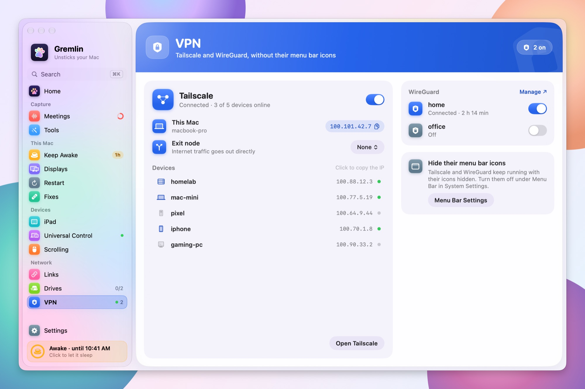</picture>
</p>

- **Tailscale.** A switch that does what Tailscale's own does (`tailscale up` and `down`), this Mac's tailnet address to copy, the exit node when your tailnet offers one, and every device with whether it's online. Click a device to copy its address, or right-click for its name. It uses the CLI that comes with the Tailscale app, and **Open Tailscale** is there for logging in or switching accounts.
- **WireGuard.** Every tunnel from the WireGuard app, with a switch and how long it has been connected. Gremlin starts and stops them as macOS VPN services, the same switch as System Settings › VPN. **Manage** opens the WireGuard app to add or edit tunnels.
- **Other VPNs** set up in System Settings show up too, with the same switch.

Home has a VPN widget and the shelf a VPN card, both with the switches.

Neither app has to be running. Keep both installed, though: WireGuard's tunnels and Tailscale's system extension come with them. Quitting Tailscale's app turns Tailscale off, and nothing turns it back on at login without the app, so Gremlin remembers whether you last turned Tailscale on or off with its switch and puts it back that way when it starts. To keep the apps but lose their icons, hide them under **Menu Bar** in System Settings; **Menu Bar Settings** on the VPN page takes you there.

## Displays

Save how your displays are arranged and put it back in one click: where each one sits, which has the menu bar, its resolution and refresh rate, its rotation, and which ones mirror which. Gremlin knows a display by its name, not by the port or hub it's plugged into, so a layout still fits after a USB-C hub brings the displays up in a different order.

<p align="center">
  <picture><source media="(prefers-color-scheme: dark)" srcset="docs/displays-dark.jpg">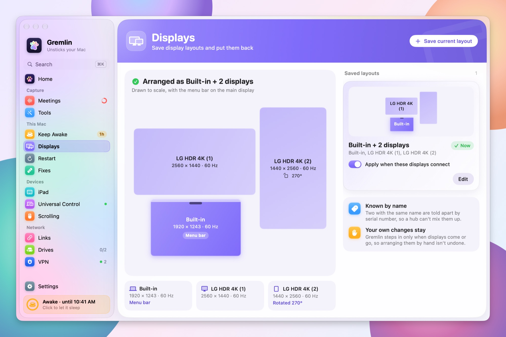</picture>
</p>

**Save current layout** saves the arrangement you have now. The drawing shows the displays as they sit, to scale, with the menu bar on the main one.

**Apply** puts a layout back. Home's Displays widget says when your displays are arranged as one you saved, and the shelf applies one in a click.

- **Apply when these displays connect** puts a layout back by itself whenever exactly its displays are connected, and after sleep if they've moved. The first layout saved for a set of displays does this, and one layout per set can.
- Arranging displays by hand in System Settings isn't undone. Gremlin only steps in when displays come or go.
- A layout with a display that isn't connected applies to the ones that are.

### Telling displays apart

macOS numbers displays that share a name, like "LG HDR 4K (1)" and "(2)", in the order they show up, so a hub can swap the numbers. Gremlin matches displays by name, and two with the same name by the serial number each one reports, so the monitor on its side stays the one that's rotated. macOS's number decides only when the serial numbers are missing or the same. The built-in display is always the built-in display.

**Use current layout** in a layout's editor saves the arrangement you have now into it, for after you've moved things around.

### How it works

Positions, resolutions and mirroring go through CoreGraphics' display configuration and are saved the way System Settings saves them, so macOS keeps them too. Rotation has no public API, so Gremlin rotates through the MonitorPanel framework behind System Settings' Displays pane, checks it's there first, and says so when a display can't rotate rather than leave it on its side.

A layout is applied by a short-lived copy of Gremlin. Once a process has rotated a display and changed the configuration, macOS can stop updating the rotation it reads back, so Gremlin itself only ever reads.

### What it can't do

- **Turning a display on or off**, HDR, brightness and color profiles aren't part of a layout.
- **Two displays with the same name and no serial number** are told apart by macOS's (1) and (2), which can swap.
- **Positions** are where macOS can put them: it closes gaps and overlaps, so a layout saved with a display that's now missing can come out shifted.

## Restart

<p align="center">
  <picture><source media="(prefers-color-scheme: dark)" srcset="docs/restart-dark.jpg">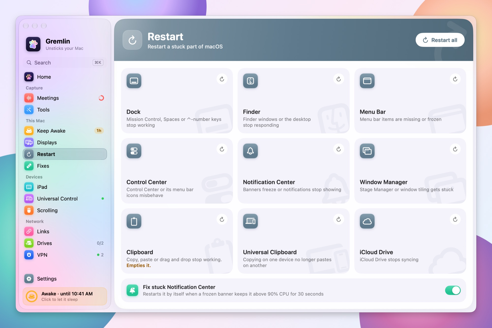</picture>
</p>

When part of macOS hangs, restarting just that part usually fixes it, without logging out. The Restart page has a tile for each part. A tile restarts its part straight away and says so. **Restart all** asks for a second click, since it also empties the clipboard. All of these run as you, and macOS starts them again right away.

| Tile | Restarts | Try it when |
| --- | --- | --- |
| Dock | `Dock` | Mission Control, Spaces or <kbd>⌃</kbd>-number shortcuts stop working, often after sleep |
| Finder | `Finder` | Finder windows or the desktop stop responding |
| Menu Bar | `SystemUIServer` | Menu bar items are missing or frozen |
| Control Center | `ControlCenter` | Control Center or its menu bar icons misbehave |
| Notification Center | `NotificationCenter` | Banners freeze or notifications stop showing |
| Window Manager | `WindowManager` | Stage Manager or window tiling gets stuck |
| Clipboard | `pboard` | Copy, paste or drag and drop stop working. This empties the clipboard. |
| Universal Clipboard | `useractivityd`, then `pboard` | Copying on one device no longer pastes on another |
| iCloud Drive | `bird` | iCloud Drive stops syncing |

### Fixes

The Fixes page has the watchers that fix macOS bugs as they happen, each with a switch and what it does:

- **Auto-Fix Lost Focus**, from [Tools](#tools). Off by default.
- **Fix Stuck Notification Center** watches for a macOS 27 bug where a banner freezes halfway in and Notification Center spins at 100% CPU. If it stays above 90% for 30 seconds, Gremlin restarts it. On by default.
- **Universal Control Watcher**, from [Universal Control](#universal-control). On by default.

## The shelf

<p align="center">
  <picture><source media="(prefers-color-scheme: dark)" srcset="docs/shelf-dark.jpg">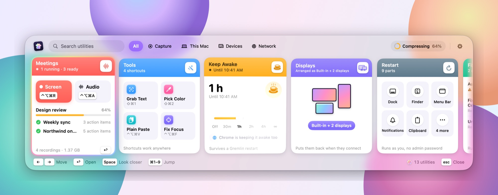</picture>
</p>

<kbd>⌃</kbd><kbd>⌥</kbd><kbd>⌘</kbd><kbd>G</kbd> raises a glass strip from the bottom of the screen with a card for each utility, live like Home's widgets: record, keep awake, connect the iPad, mount a drive or flip a VPN without opening the window. Type to search, or pick a group.

| Key | Does |
| --- | --- |
| <kbd>←</kbd> <kbd>→</kbd> | Move between cards |
| <kbd>Return</kbd> | Open the card into that utility's own cards |
| <kbd>Space</kbd> | Look closer at a card |
| <kbd>⌘</kbd><kbd>1</kbd>–<kbd>9</kbd> | Jump to a card |
| <kbd>Esc</kbd> | Go back, or close the shelf |

## Settings

<p align="center">
  <picture><source media="(prefers-color-scheme: dark)" srcset="docs/settings-dark.jpg">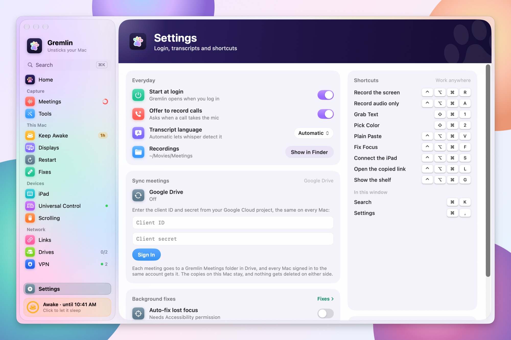</picture>
</p>

**Settings**, at the bottom of the sidebar, turns features on and off, and Gremlin remembers them between launches.

- **Start at login**: on after installing.
- **Offer to record calls**: the call prompt above.
- **Transcript language**: Automatic, or a language for whisper to assume.
- **Sync meetings**: [Google Drive sync](#sync-between-macs).
- **Background fixes**: the [Fixes](#fixes) switches.
- **Shortcuts**: every shortcut in one place.

Everything Gremlin does is logged to `~/Library/Logs/Gremlin.log`.

## Make the glass yours

The floating surfaces, the link picker and the call and warning prompts, take their look from one place: `GlassLook` in [`Glass.swift`](Glass.swift). It follows the system's Light or Dark Mode. Light looks like a regular macOS menu, and Dark is very dark, so either reads well over any window. Both are Liquid Glass over a blur, and each knob can be changed without rebuilding:

```sh
defaults write com.bunniesinc.gremlin glass.dark.tint -float 0.7
defaults write com.bunniesinc.gremlin glass.material clear
```

`glass.<knob>` changes both modes, and `glass.light.<knob>` or `glass.dark.<knob>` changes just one. The next surface that opens uses it, and `defaults delete com.bunniesinc.gremlin glass.dark.tint` goes back to the default.

| Knob | Light | Dark | What it changes |
| --- | --- | --- | --- |
| `material` | `frosted` | `frosted` | `frosted` is Liquid Glass over a blur that reads well anywhere; `regular` is Liquid Glass alone; `clear` is see-through and only readable over plain backgrounds |
| `tint` | `0.5` | `0.5` | How strongly the tint color covers the blur |
| `tintColor` | `#FFFFFF` | `#0C0A14` | The tint color |
| `rim` | `0.1` | `0.14` | How strong the edge is |
| `textShadow` | `0` | `0` | A shadow behind text, for see-through glass |
| `subtext` | `0.55` | `0.6` | How strong secondary text is |
| `card` | `0.04` | `0.06` | How filled the cards are |
| `control` | `0.07` | `0.1` | How filled buttons, pills and tiles are |

## Install

Requires macOS 27 and the Xcode Command Line Tools (`xcode-select --install`).

```sh
git clone https://github.com/alicin/gremlin.git
./gremlin/install.sh
```

This builds `/Applications/Gremlin.app`, signs it, starts it, and adds it as a login item. Run `install.sh` again after pulling changes. It needs an admin account to write to `/Applications`, but no password.

For meeting transcripts and the compressed video, also install whisper.cpp and ffmpeg:

```sh
brew install whisper-cpp ffmpeg
```

The app is signed with a self-signed "Gremlin Code Signing" certificate that the installer creates in your login keychain the first time. macOS ties permissions to that certificate, so they survive rebuilds. The first build may ask to let `codesign` use the key; choose Always Allow.

### Permissions

macOS asks for each permission the first time a feature needs it:

| Permission | Needed for |
| --- | --- |
| Screen Recording | Grab Text, recording meetings (audio-only ones too, since the call's sound comes through screen capture) |
| Microphone | Recording your side of a meeting |
| Accessibility | Auto-Fix Lost Focus, flipping a device's scrolling, and the paste step of Plain Paste (without it, the clipboard is still made plain and you press <kbd>⌘</kbd><kbd>V</kbd>) |
| Local Network | Pairing with another Mac, and drives on servers in your local network |
| Notifications | Universal Control reset results, finished transcripts |
| Calendars | Naming meeting recordings after the event |
| App data | Reading browser profiles, only when you press **Find profiles** |

The shortcuts use Carbon hotkeys, so they need no permission.

## How the Universal Control fix works

### The bug in detail

Seen on macOS 27.0 (26A428). When the other Mac wakes or comes back into range, Universal Control runs an "initial sync". If the other Mac isn't ready yet, all 6 retries fail. This Mac then marks the peer `valid=false` and never retries on its own. The other Mac keeps opening a connection every 60 s over AWDL, gets no answer, and hangs up, forever. It only recovers when the peer disappears and comes back, or Universal Control is toggled.

### Detecting and resetting

It streams Universal Control's logs as the current user:

```sh
/usr/bin/log stream --style ndjson --predicate 'process == "UniversalControl" AND category == "SYNC"'
```

- **Gave up:** `IDS <peer>: Initial Sync (Retry 6 of 6)`, then `IDS <peer>: Initial Sync Failed: …`, then `IDS <peer>: available=true, valid=false`
- **Recovered:** `In-Circle Devices: [<peer>]`
- **Peer gone:** `IDS <peer>: Device Unavailable` / `Device Lost`

`<peer>` is any 8-hex-digit device ID. How long the retries take depends on the failure. `-6722` means the other Mac didn't answer, and each retry waits up to ~30 s. `-71143` means the other Mac reset the connection during pairing verification, and all 6 retries fail within seconds. `-6773` is an iPad refusing because it is busy as a Sidecar display, for this Mac or another one. No reset helps with that, so the watcher leaves it alone.

When a peer gives up, the watcher waits 10 s and flips the same setting as the System Settings toggle, off for 3 s and back on:

```sh
defaults -currentHost write com.apple.universalcontrol Disable -bool true
sleep 3
defaults -currentHost write com.apple.universalcontrol Disable -bool false
```

The flip makes the peer go unavailable and available again and starts a fresh initial sync. The watcher ignores that unavailable/available pair and judges the reset by the result of the new sync: the peer joining is a recovery, and giving up again is a failed reset. Failed resets back off (10 s, 1 min, 5 min), then it tries again every 30 min while the peer stays stuck. It never resets a peer that is away, and it restarts `log stream` if it exits. If Gremlin quits mid-flip, Universal Control is switched back on at quit or on the next launch.

Flipping it on this Mac does not always help. When the other Mac is the one refusing the connection (`-71143`), resets here change nothing and it needs a toggle over there. That is what pairing is for.

### Two Macs: pairing and coordination

Install Gremlin on both Macs and choose **Pair another Mac…** on each within 2 minutes. Both show a 6-digit code. Click Pair on both if the codes match. The first time, macOS asks to allow Gremlin to find devices on the local network.

Once paired, the Macs talk over the local network (Bonjour, `_gremlin._tcp`, TCP port 47101), not over the AWDL link Universal Control uses. When Bonjour can't see the other Mac, Gremlin tries the addresses it last reported, which includes its Tailscale address. Only three messages exist: `status`, `reset` (flip Universal Control on the receiving Mac) and `stuck` (tell the other Mac what this one sees). Each is signed with a key agreed during pairing (Curve25519, HMAC-SHA256), with a timestamp and nonce so it can't be replayed. The key is kept in the login keychain.

Only one of the two Macs runs the resets, so they don't toggle each other at the same time. The other one reports what it sees to that Mac and waits. When a Mac logs `-71143`, the other Mac refused, so the first reset happens on the refusing Mac. Otherwise it happens on the Mac that saw the failure. The next ones go to the other Mac, then both. If the other Mac can't be reached, each Mac falls back to resetting itself.

The Universal Control page does the same by hand: on this Mac, on the other one, or on both.

Resets and their results go to Home, to a notification, and to `~/Library/Logs/Gremlin.log`.

Don't reset Universal Control any other way. `killall UniversalControl` is ignored, `launchctl kickstart -k gui/$UID/com.apple.ensemble` is refused by SIP, and `kill -9` gets it relaunched but left the other Mac holding a dead session until Universal Control was toggled on that Mac.

<details>
<summary><b>Uninstall</b></summary>

Turn off Start at Login, quit Gremlin, then:

```sh
rm -rf /Applications/Gremlin.app
rm -rf ~/Movies/Meetings  # only if you don't want the recordings
rm -rf ~/Library/Application\ Support/Gremlin
defaults delete com.bunniesinc.gremlin
security delete-generic-password -s com.bunniesinc.gremlin.peer ~/Library/Keychains/login.keychain-db
security delete-generic-password -s "Gremlin Drives" ~/Library/Keychains/login.keychain-db  # once for each saved drive password
security delete-generic-password -s com.bunniesinc.gremlin.google ~/Library/Keychains/login.keychain-db  # three times, for meeting sync
security delete-identity -c "Gremlin Code Signing" ~/Library/Keychains/login.keychain-db
```

</details>
